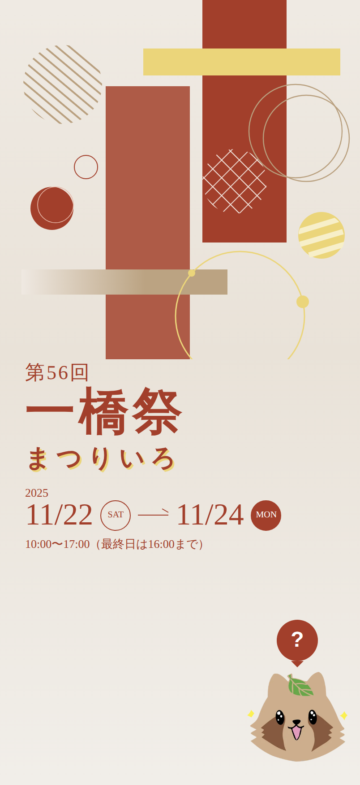
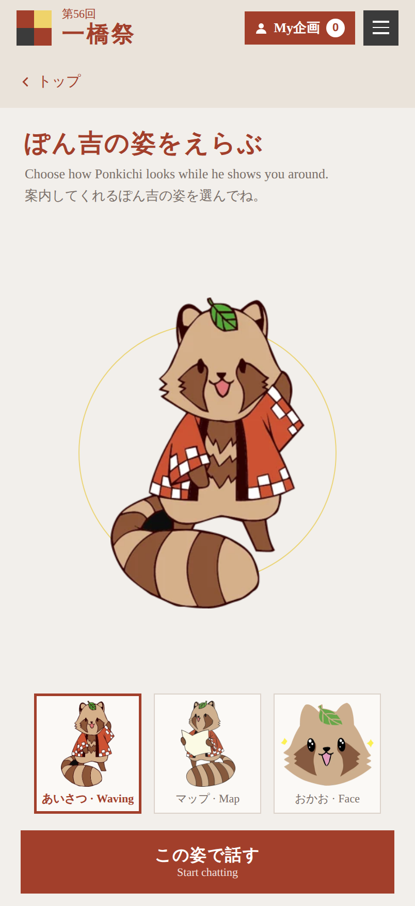
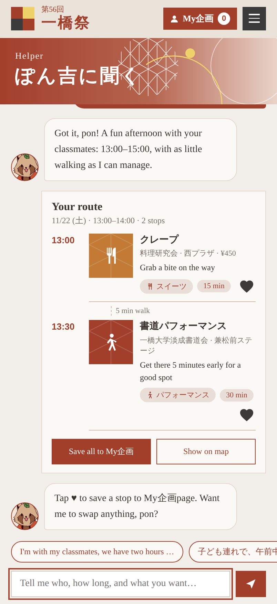

# ぽん吉 Helper · 一橋祭 Web Helper Prototype

A mobile prototype of a conversational helper for **Ikkyosai (一橋祭)**, the university festival of Hitotsubashi University. Visitors describe their plans in one sentence, and Ponkichi (ぽん吉) builds a festival route for them.

> "I'm with my classmates, we have two hours this afternoon, and we want a snack and a show."

| Home | Choose avatar | Chat & route |
|---|---|---|
|  |  |  |

## Features

- **Home screen** styled after the 56th Ikkyosai key visual, with Ponkichi and a "?" bubble as the entry point
- **Avatar picker**: choose Ponkichi's look (waving, with a map, or face) before chatting
- **One-sentence planning** that understands time of day, duration, group and wants (food, shows, talks, hands-on, exhibits)
- **Route cards** in the style of the official project search, with walking times and a note when crossing 大学通り
- **Save to My企画page** with heart buttons and a "save all" action
- **English, Japanese and Chinese**: Ponkichi replies in the visitor's language, ending with "pon / ぽん"
- **iPhone 17 Pro frame** (402 × 874 pt, 150.0 × 71.9 mm) on desktop; full screen on phones

## Run it

No build step. Open `index.html` in a browser, or publish the repository with **GitHub Pages**
(Settings → Pages → Deploy from branch → `main` / root).

## Project structure

```
index.html      # the whole prototype (HTML, CSS, JS)
assets/         # Ponkichi avatar images
docs/           # screenshots for this README
```

## Customizing the data

Project data lives in the `P` array near the top of the `<script>` in `index.html`.
Each project has an id, title (`t`), group (`g`), genre (`k`: `food`, `show`, `talk`, `try`, `exhibit`), venue (`v`),
and either a start/end time (`s`, `e`) or opening hours and duration (`open`, `dur`).
Venues are mapped to the west or east side of campus in `ZONE` to estimate walking time.

## Notes

- **Sample data:** project titles are taken from the 56th Ikkyosai website, but times, venues and club names are placeholders for the prototype.
- **Planner:** on GitHub Pages, routes come from a rule-based planner that runs in the browser. The code also contains an optional path that uses Claude when the page runs inside claude.ai; it is skipped automatically elsewhere.
- **Artwork:** Ponkichi is the mascot of Ikkyosai. The avatar images are used for this prototype only; rights belong to their respective owners.

---

## 中文說明

一橋祭網站的對話式導覽助手原型。使用者用一句話描述同行對象、時間與想做的事，ぽん吉就會排出逛祭典的路線。包含首頁、選頭像流程與聊天室，直接開啟 `index.html` 即可使用，也可以用 GitHub Pages 發布。企劃的時間、場地與社團名稱為範例資料。
